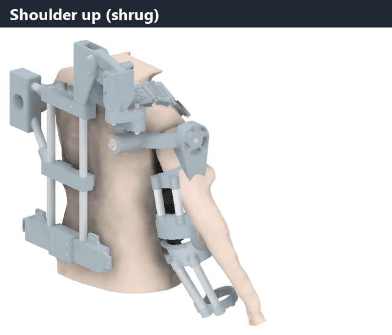
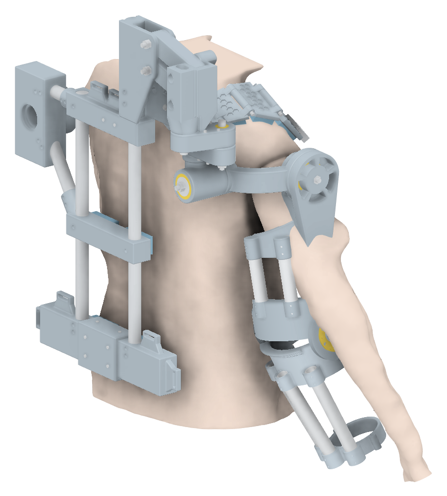
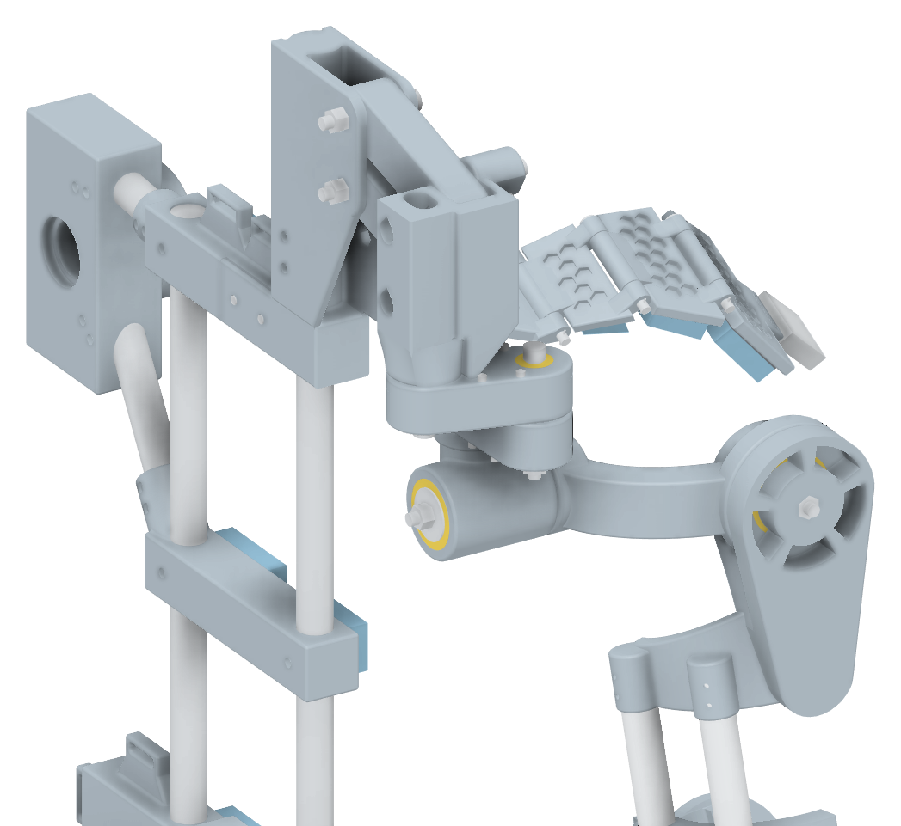
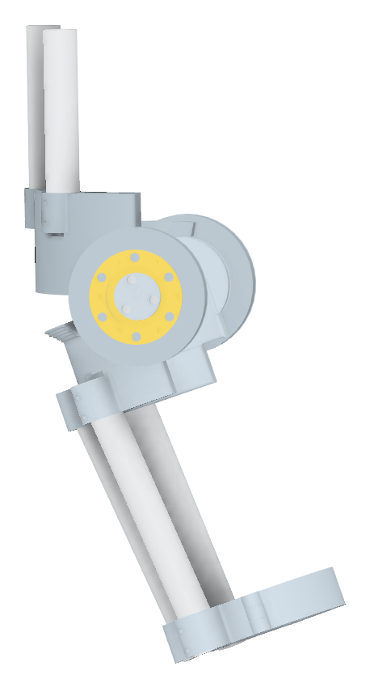
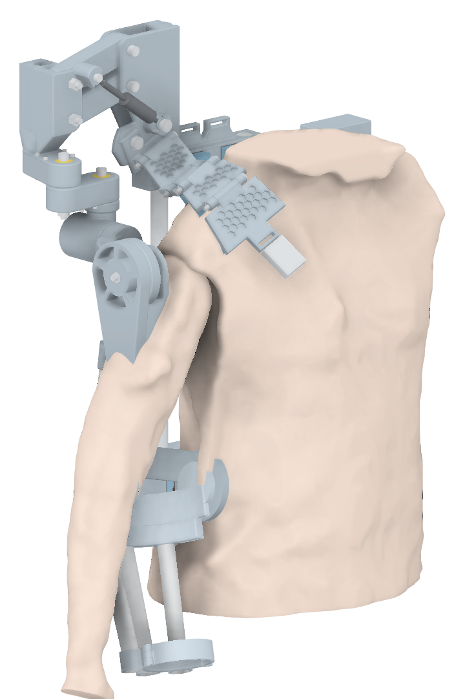

# CDX-3R

A right-arm exoskeleton made of 3D-printed parts, PVC pipe and off-the-shelf bearings, designed around a
3D scan of the wearer's body. **3R** = three revolute joints on the right arm (shoulder abduction, shoulder flexion,
elbow flexion), carried by a shoulder girdle that follows the shoulder up, down, forward, back, in and out.



*The shoulder moves up, down, forward, back, out and in; then the arm goes out to the side, forward, and the elbow
bends. The scanned arm moves with the exo. Rendered from the Fusion model (`cad/fusion/render/motion.py`).*

> Work in progress. The passive structure (frame, shoulder girdle, joints, shoulder rest, harness) is designed and
> being printed; actuation (motors, cables, battery) is not designed yet. Not a certified device.

## How it works



**Back frame.** Two vertical PVC pipes (21.5 mm OD) form the backbone, held by printed bottom, middle and top nodes.
The right backbone runs on up into the shoulder tower; on the left a short beam and a diagonal brace a block that
will carry the battery. Foam pads on the nodes rest on the back.



**Shoulder girdle (follows your shoulder blade).** Your shoulder joint itself moves when you shrug, reach or squeeze
back, so the exo's shoulder has to move with it:
- *Up / down:* a tower on the top node carries a parallelogram lift (two links on 608 bearings) with a 22 N gas strut
  that takes most of the arm's weight. About 60 mm up, 20 mm down.
- *Forward / back and in / out:* under the lift hang two SCARA arms (printed trays with GT2 belts and pulleys inside).
  The belts keep the shoulder housing pointing the same way wherever the arms move it.
- *Shoulder rest:* a chain of padded, hinged blades over the top of your shoulder, angle set with one screw, with
  the shoulder strap's buckle at its front end.

**Shoulder hinges (2 joints).**
- *Abduction* (arm out to the side): 2 × 6806 bearings in the housing at the end of the SCARA arms, on an M8
  through-bolt; a curved yoke carries it round the shoulder.
- *Flexion* (arm forward/back): 2 × 6808 bearings in the yoke's end, inside the spoked upper-arm link.
- Both axes pass through the shoulder joint's centre, so the exo turns with the arm instead of sliding on it.



**Elbow.** Upper-arm and forearm units of three PVC pipes each, joined at a two-sided hinge on 2 × 6806 bearings
with bolted axles and spoked covers; stops at straight and 135 degrees. A wrist ring and cuff hold the forearm.

**Harness.** Worn like a backpack: shoulder straps (from the shoulder rest's buckle), chest and waist straps, all 1"
webbing, plus two upper-arm straps and the wrist cuff. A MuJoCo test (`cad/sim/exo_sim.py`) checks the strap forces.




## Fitted to a body scan

The wearer was captured as a Gaussian splat. `cad/scan/` turns it into a clean body mesh with landmarks
(shoulder joint centre, elbow, wrist). The layout and every part are checked against it: collisions,
clearance to the body at rest (the arm rests at 20 degrees abduction) and over the shoulder's range
(abduction 20–60 degrees, flexion -20 to 120 degrees), plus the elbow's 0–135 degree sweep.

## Build it

| What | Where |
|---|---|
| Step-by-step assembly guide, with animations and PVC cut lengths | [docs/ASSEMBLY.md](docs/ASSEMBLY.md) |
| Parts to buy (bearings, screws, inserts, webbing), with links | [BOM.md](BOM.md) |
| Print files (Bambu P1S, PETG): pre-oriented and checked, import as is | [prints/shoulder-back-v3/](prints/shoulder-back-v3/) and [prints/elbow-test-v10/](prints/elbow-test-v10/) |
| Fusion models | [cad/fusion/models/](cad/fusion/models/) (`cdx-3r-shoulder-back.f3d`, `cdx-3r-elbow-concepts.f3d`) |
| Scripts that build the models | [cad/fusion/](cad/fusion/) (`shoulder.py`, `girdle_b.py`, `shoulder_rest.py`, `concepts.py`, `fxlib.py`) |
| Print export, orientation and checks | `cad/fusion/export_prints.py`, `orient_stls.py`, `print_validate.py` (run on export and in the git hook) |
| Strap-force physics test | [cad/sim/](cad/sim/) (MuJoCo) |
| Body-scan pipeline | [cad/scan/](cad/scan/) |
| Lessons learned (read before changing the design) | [cad/fusion/LESSONS.md](cad/fusion/LESSONS.md) |

## Not done yet

- Actuation: motors, cable drive, battery, controller.
- Wrist-cuff latch (a magnet-assisted snap latch is planned).
- Dedicated shoulder stop pads (abduction 60 degrees, flexion 120 degrees).
- Left arm (the left block is reserved for the battery for now).

## Website

The design portal site lives in `src/`:

```bash
npm install
npm run dev     # http://localhost:8080
```
