# How to build the CDX-3R arm exo

Watch each animation, then do the same. Open **Details** under a step only if the animation isn't enough.

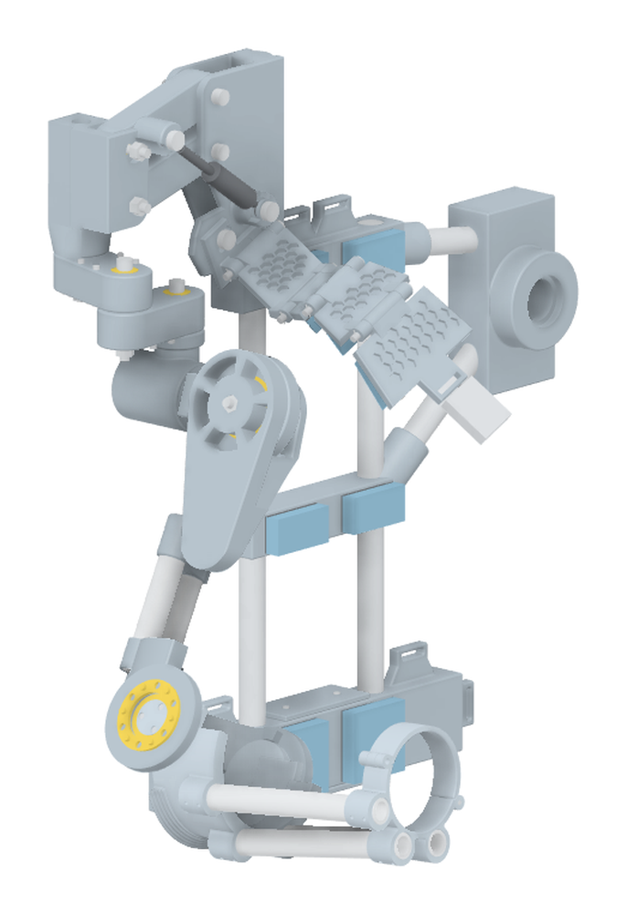

**About 6–8 hours** after printing; each step is a good place to stop. **Grown-up needed** for the soldering iron
and cutting PVC.

> ⚠ = do it **in this order**, or it can't be done later.

| Step | | ⚠ |
|---|---|---|
| 0 | [Get ready](#0-get-ready) | |
| 1 | [Elbow](#1-build-the-elbow) | |
| 2 | [Back frame](#2-build-the-back-frame) | |
| 3 | [Shoulder tower](#3-put-on-the-shoulder-tower) | 2 hidden nuts |
| 4 | [Lift](#4-build-the-lift) | 2 hidden nuts |
| 5 | [SCARA arms](#5-build-the-scara-arms) | 1 hidden nut, the M8 × 75 bolt |
| 6 | [Shoulder hinge](#6-build-the-shoulder-hinge) | 1 hidden nut |
| 7 | [Shoulder rest](#7-build-the-shoulder-rest) | pin each piece as it goes on |
| 8 | [Join the arm](#8-join-the-arm-to-the-shoulder) | |
| 9 | [Straps](#9-add-the-straps) | |
| 10 | [Try it on](#10-try-it-on) | |
| 11 | [Gripper](#11-add-the-gripper-optional) (optional) | inserts first; spring last |

---

## 0. Get ready

<b>Printed parts</b>

Print everything in PETG. Write the part's name on it as it comes off the printer.

**Elbow** ([prints/elbow-test-v10](../prints/elbow-test-v10/)): fit-test pieces (print first), 01 upper-arm elbow
piece, 02 forearm elbow piece, 03 bearing axle × 2, 04 round cover × 2, 05 wrist ring, 06 wrist cuff.

**Frame, shoulder and rest** (folder named when the print files are exported; each part's print orientation is in its
README):

| Part | How many |
|---|---|
| Bottom node L + R, splice plate | 1 each |
| Middle node, top node, left shoulder block | 1 each |
| Shoulder tower | 1 |
| Lift link upper + lower, lift carriage | 1 each |
| SCARA link 1 tray + lid, link 2 tray + lid | 1 each |
| End plate + shoulder housing | 1 |
| Pulleys (35 teeth) | 4 |
| Spacers: thick Ø11 × 4, thin Ø11 × 1 | 8 thick, 6 thin |
| Abduction sleeve, yoke, flexion sleeve, arm link | 1 each |
| Shoulder rest: bracket, root arm, blades 1–3 | 1 each |

<b>Bought parts</b> (links in <a href="../BOM.md">BOM.md</a>)

| Part | How many |
|---|---|
| **6806** bearing (30 mm hole) | 4 |
| **6808** bearing (40 mm hole) | 2 |
| **608** bearing (8 mm hole) | 16 |
| M3 brass heat-set **insert** | 38 |
| **M3 × 8** screw / **M3 × 12** screw | 30 / 8 |
| **Pipe screw** #4 × 3/8" | 41 |
| **M8 × 100** bolt | 1 |
| **M8 × 75** bolt | 1 |
| **M8 × 55** bolt | 7 |
| M8 **lock nut** | 9 |
| M8 washer, **32 mm** wide (not 30) | 1 |
| **Clevis pin** M6 × 70 + **R-clip** | 4 |
| **M6 × 16** socket head screw + **M6 nut** | 2 + 2 |
| **M6 × 65** socket head (rest pivot) + **M6 nut** | 1 + 2 |
| **GT2 belt loop** 200 mm × 6 mm | 2 |
| **Gas strut** 180 mm, 22 N, eyelet ends | 1 |
| Pin 4 × 25 mm | 1 |
| ½" foam + hook-and-loop (sticky-backed) | 1 roll each |
| PVC pipe ½" (21.5 mm outside) | ~2.5 m |
| 1" strap kit | 1 |

<b>Tools</b>

Soldering iron (cone tip) · hex keys **2.5**, **5** and **6 mm** · **13 mm** wrench · small pliers ·
long thin screwdriver or 8 mm rod · Phillips #1 screwdriver · PVC cutter · sandpaper · ruler in **mm** + marker ·
super glue · masking tape.

<b>PVC cut list</b>

| Piece | Length | How many | Step |
|---|---|---|---|
| Forearm pipe | **185 mm** | 3 | 1 |
| Upper-arm pipe | **127 mm** | 3 | 1 |
| Backbone left | **412 mm** | 1 | 2 |
| Backbone right (runs up into the tower) | **568 mm** | 1 | 2 |
| Short beam (left) | **102 mm** | 1 | 2 |
| Diagonal (left) | **131 mm** | 1 | 2 |

Mark, wrap tape at the mark, cut square, sand the burr, write the name on it. 1 mm short is fine; long is not.

<b>Skills</b>: inserts, bearings, pipe screws, hidden nuts

- **Insert:** iron at ~225 °C, insert on its hole, let it sink in by itself until **flush**. Practise on a fit-test
  piece.
- **Bearing:** square over its pocket, press on the **outer ring** (thumbs, or a flat block of wood). Never hammer.
- **Pipe screw:** pipe all the way in, screw until **snug**, then stop (more strips the pipe). 2 per pipe end.
- **Hidden nut** ⚠: drop it into its six-sided pocket **before** the next part covers it; tape over it. The pocket
  stops it turning, so you only turn the bolt.

<b>Fit test first</b>

A 6806 should press into the test pocket with firm thumb pressure and stay; a 608 the same in a SCARA tray. PVC should
slide into the test hole snug, no wobble. If not, fix the printer settings before printing big parts.

---

## 1. Build the elbow

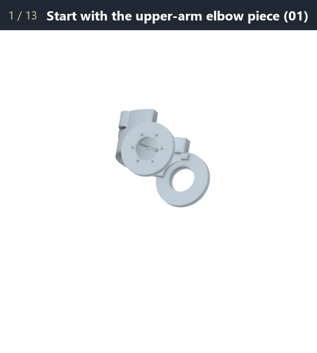

**Parts:** 01–06, 2 × 6806, 18 inserts, 18 M3 × 8, 18 pipe screws, 4 mm pin · **Cut:** 3 × 185 mm, 3 × 127 mm

Details

1. 12 inserts into 01 (6 around each bearing hole, both sides); a 6806 into each round hole from the inside.
2. Slide 02 between the sides of 01; 3 inserts into each hub.
3. An axle (03) through each bearing into the hub; 3 × M3 × 8 each, snug.
4. A cover (04) each side, 6 × M3 × 8 each.
5. Forearm pipes into the bottom (they lean in toward the wrist on purpose), wrist ring on their ends, cuff on with the
   4 mm pin (drop of glue at one end).
6. Upper-arm pipes into the top. 2 pipe screws per pipe end.

**Check:** bends smoothly from straight to 135° and stops at both ends. The cuff's latch isn't designed yet: hold it
with a strap.

---

## 2. Build the back frame

**Parts:** bottom node L + R, splice plate, middle node, top node, left shoulder block, 8 inserts, 8 M3 × 8, ~15 pipe
screws, foam + hook-and-loop · **Cut:** 412, 568, 102, 131 mm

Details

- The **right backbone (568)** is the long one: it runs up through the top node into the shoulder tower.
- The left shoulder block holds the battery later; the right side has no block (the tower takes its place).
- Back pads: 6 pieces of foam 60 mm wide, as tall as each node, on the **body side**, one each side of the spine. The top-right pad sits on the tower's side plate (step 3), over two screw heads: that's fine, the foam takes it.

**Check:** lift it by the top and shake: stiff, no loose pipes.

---

## 3. Put on the shoulder tower

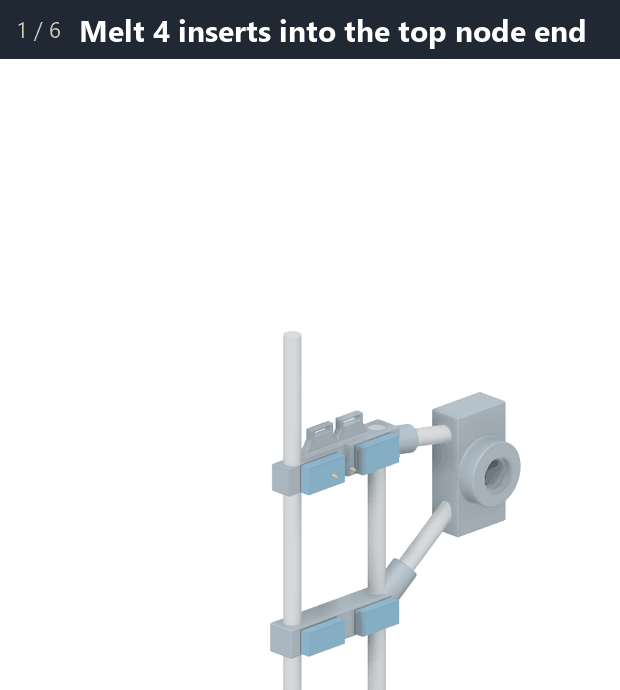

**Parts:** shoulder tower, 4 inserts, 4 M3 × 8, 2 pipe screws, **1 M6 nut**

> ⚠ **Nut first.** Before the tower goes on, put the gas-strut M6 nut into its pocket from **inside** the tower,
> and tape it.
>
> ⚠ **Tower printed before 18 Oct 2026** (it has a nut pocket next to the round boss and no hole in the boss): drill
> a **Ø6.5 mm** hole through the centre of the boss and the **front plate only** (3 mm pilot first, square to the
> plate). Its back plate has no material around that line (the slanted edge crosses it), so this tower uses the
> **retrofit** in step 7: M6 × 30 + printed backer inside the tower, no through-bolt. See
> [bugs/rest-bracket-attachment](bugs/rest-bracket-attachment.md).

Details

- Inserts go into the **thin right end** of the top node, 2 front, 2 back.
- The tower slides **straight down** over the right backbone until its sides cover the node end down to its bottom
  edge. The outsides should be flush.

**Check:** the tower doesn't rock; the seam to the node is a thin line.

---

## 4. Build the lift

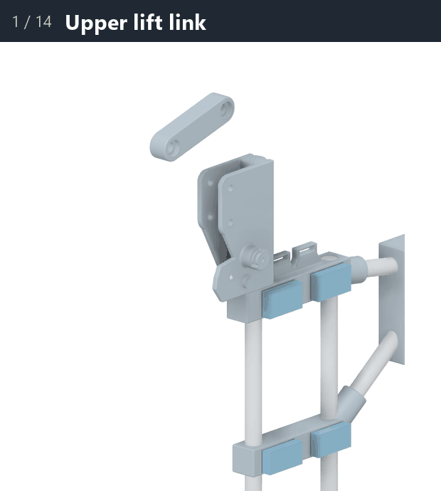

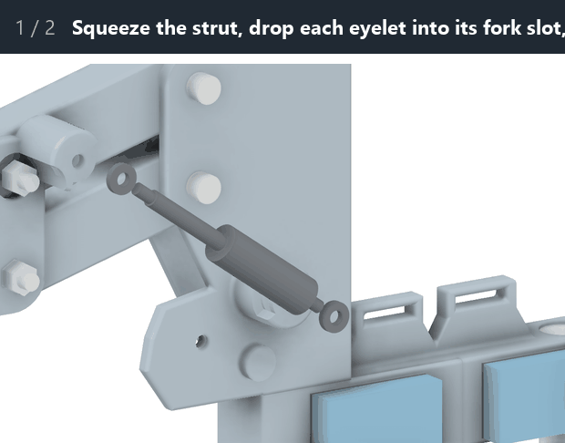

**Parts:** 2 lift links, carriage, 8 × 608, 4 × M8 × 55, 5 lock nuts, gas strut, 2 M6 × 16 screws, 1 M6 nut

> ⚠ **Nuts first** in the carriage before it goes on: one lock nut **down the slot in its top** (it narrows to a
> round guide at the bottom; steer the nut straight with a screwdriver into its six-sided pocket) (for the SCARA in step 5) and an **M6 nut** in the pocket behind the round ear (for the strut).

Details

- Press 2 bearings into each end of both links **before** they go in.
- The links drop into the tower's fork **from above (upper link) and below (lower link)**, never sideways through the
  plates.
- Tower pivots: bolt heads at the **front**, lock nuts at the back.
- The carriage comes **up from below** onto the link ends. Its pivot bolts go in from the **back**, head first down the
  round tunnels (the tunnels are wider than the head); the 6 mm key reaches the head down the tunnel. Lock nuts at the
  front.
- **Gas strut:** squeeze it a little, drop each flat eyelet into the open side of its ear's slot (a fork) and let go:
  the strut pushes the eyelets home into the round end of the slots. Then an M6 × 16 through each fork and
  eyelet into the hidden nut, snug with the 5 mm key. The screw clamps the fork, not the eyelet, so the strut still swings. Body
  end on the tower.

**Check:** the carriage moves smoothly ~6 cm up and ~2 cm down; the strut holds it near the middle.

---

## 5. Build the SCARA arms

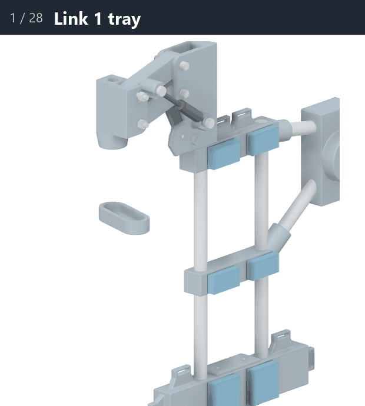

**Parts:** link 1 + link 2 (tray + lid each), end plate, 4 pulleys, 8 thick + 6 thin spacers, 2 belts, 8 × 608,
8 inserts, 8 M3 × 12, 2 × M8 × 55, **M8 × 75**, 3 lock nuts

> ⚠ **Nut first** in the end plate: a lock nut in the pocket on its **top**, before it goes under link 2.

Details

Build each link on the table, then hang it.

1. Tray: 2 bearings, 4 inserts; on each bearing a thick spacer, a pulley, a thick spacer; belt around both pulleys.
2. Lid (with its 2 bearings pressed in) on: link 1's lid goes on **top**, link 2's **underneath**. 4 × M3 × 12.
3. **S0:** link 1 under the carriage, thin spacer between; M8 × 55 **up from below** into the waiting nut.
4. **Elbow:** link 2 under link 1, thin spacer between; thin spacer + **75 mm bolt down from the top**, thin spacer +
   lock nut underneath. Tighten until the pulleys turn **with** the bolt.
5. **E:** end plate under link 2, thin spacer between; thin spacer + M8 × 55 **down from the top** into the nut.

Line-up trick: before each bolt, push a long thin screwdriver through bearings, spacers and pulley; push the bolt in
as you pull the screwdriver out.

**Check:** the end plate slides smoothly forward/back/in/out and its round housing always **points the same way**.

---

## 6. Build the shoulder hinge

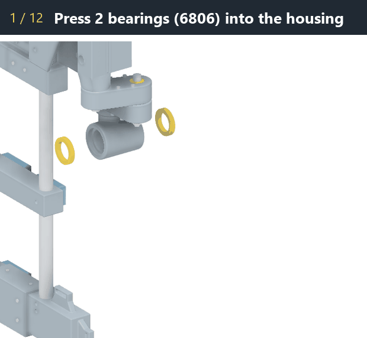

**Parts:** yoke, abduction sleeve, flexion sleeve, arm link, 2 × 6806, 2 × 6808, M8 × 100, M8 × 55, 2 lock nuts,
32 mm washer

> ⚠ **Nut first:** lock nut into the hex pocket on the spoked side of the arm link, before it goes over the yoke.

Details

- Sleeve end must be **flush** with the back bearing (fingernail doesn't catch).
- The **32 mm** washer rests on the bearing's inner ring. A 30 mm washer falls into the bearing hole: wrong washer.
- Hold the bolt with the 6 mm key, tighten the nut with the 13 mm wrench until firm.

**Check:** the yoke swings up/down with no front-back wiggle; the arm link swings forward/back with a ~2 mm gap each
side.

---

## 7. Build the shoulder rest

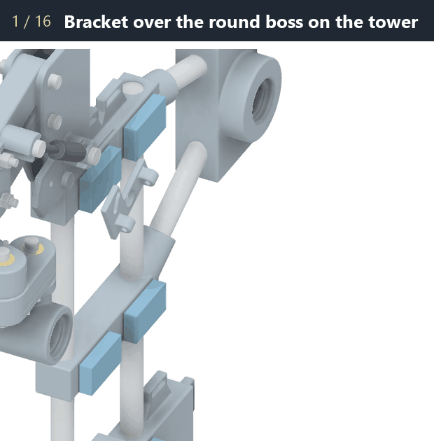

**Parts:** bracket, root arm, blades 1–3, 4 clevis pins + R-clips, M6 × 65 bolt, 2 printed washers, printed pivot spacer, 2 M6 nuts,
buckle, foam, hook-and-loop

> ⚠ **Pin each piece as soon as it's on**, root arm first, then blade 1, 2, 3: the pin + R-clip holds it, so nothing
> hangs loose.

Details

- Bracket over the round boss on the tower. M6 × 65 from the **front**: washer, bracket, boss, front plate; hold the
  **pivot spacer** (the 27 mm tube) in the gap between the tower's two plates, reach in from the fork's open side,
  and push the bolt through it, then through the back plate; at the back a washer and 2 nuts. The spacer keeps the
  plates from being squeezed together when you tighten.
- **Retrofit (towers printed before 18 Oct):** M6 × **30** from the front: printed washer, bracket, boss, front plate;
  inside the tower, the printed **backer** (`retrofit/rest_backer_retrofit.stl`, flat side against the plate) with an
  M6 nut in its hex pocket. Put the nut in the pocket, hold the backer behind the hole from the fork's open side,
  thread the bolt in. No spacer, no back washer, no second nut. Snug the first nut, then lock the second against it (two 10 mm spanners).
  Leave it loose enough to turn the bracket.
- Each piece's middle knuckle goes between the two knuckles of the piece before it.
- Foam pads a little smaller than each blade, on with hook-and-loop (they come off for washing).
- Shoulder strap through the slot at the front of blade 3, buckle on.

**Check:** the chain folds freely; loose, the bracket turns; tight, it stays put when you pull the rest forward hard.

---

## 8. Join the arm to the shoulder

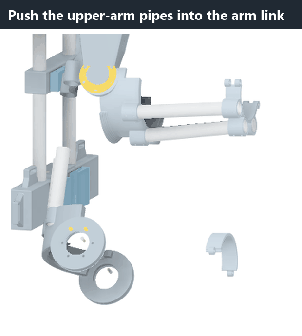

**Parts:** the elbow from step 1, 6 pipe screws

Details

Upper-arm pipes all the way into the arm link, 2 pipe screws each.

**Check** (slowly): shrug (carriage rides up ~6 cm); reach and squeeze (housing keeps pointing forward); arm out to
60–90°; swing forward and a little back; elbow straight to 135°. Nothing rubs.

---

## 9. Add the straps

**Parts:** 1" strap kit

Details

- **Shoulder:** from the buckle on the shoulder rest, down the chest, under the arm, back to the bottom-node tab
  (with a slider). Left side: tie to the top-node tab.
- **Chest:** across, buckle in the middle. **Waist:** through the bottom node's side tabs, buckle in front.
- **Arm:** **two** upper-arm straps (one a third of the way down, one just above the elbow) + the wrist cuff. With only
  one, the exo twists around your arm.

---

## 10. Try it on

Details

1. With a helper: shoulder strap, then waist, then chest.
2. Waist strap tightest: the weight sits on your **hips**.
3. Loosen the rest pivot bolt (5 mm key at the front, spanner on the back nuts), let the rest lie flat on your
   shoulder, tighten.
4. Close the cuff and both arm straps; move slowly through every motion. Note any pinch.
5. After the first wear, re-check every M8 nut, the M6 screws and the pipe screws.

---

## 11. Add the gripper (optional)

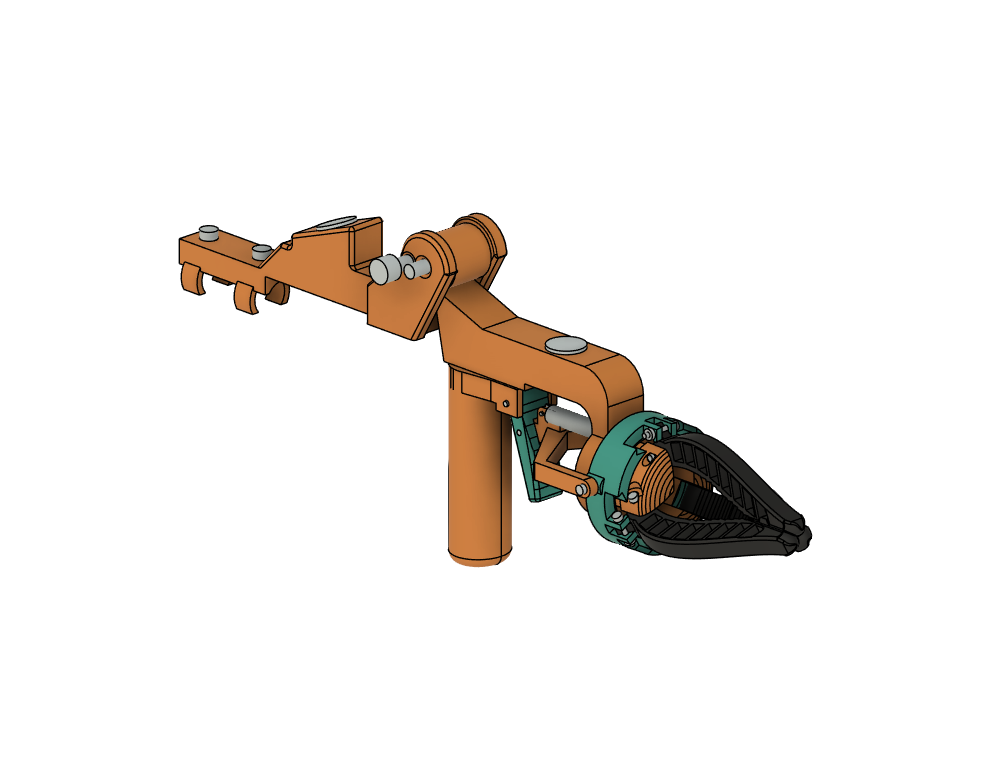

Prototype 3: a three-claw gripper on a pistol grip, clamped to the forearm's middle pipe behind the wrist. Squeeze the
trigger and the three claws open; let go and they close. It folds up and back over the forearm when you don't need it.

<b>Printed parts and hardware</b>

Print files: [prints/gripper3-v1](../prints/gripper3-v1/) (pre-oriented, checked).

| File | Material | Qty | Note |
|---|---|---|---|
| 01_gripper_base | PETG | 1 | supports on |
| 02_gripper_carrier | PETG | 1 | on its side, tree supports under the hub and dome |
| 03_gripper_grip | PETG | 1 | |
| 04_gripper_trigger | PETG | 1 | lies on its flat back face |
| 05_gripper_y_link | PETG | 1 | |
| 06_gripper_collar | PETG | 1 | |
| 07_gripper_claw_TPU_x3 | TPU 95A | 3 | flat, slow (20–30 mm/s) |

Hardware ([BOM](../BOM.md), gripper prototype 3): 11 ruthex M3 inserts, M3 × 12 (6), M3 × 20 (4), M3 × 30 (4), M3 nylocs
(4), 2 M3 × 10 knurled thumb screws, M8 × 55 + nyloc, the M8 index plunger (pull ring), one extension spring
(1.2 × 10 × 45 mm, from the Keadic kit), two 22 mm hook-and-loop dots.

> ⚠ **Inserts first** (soldering iron): 2 in the base's clamp holes (from the top), 4 in the bridge's underside, 3 in
> the dome from the outside (claw pivots), 2 in the collar's side lobes. Every one is hard to reach later.

### 11.1 Base on the pipe

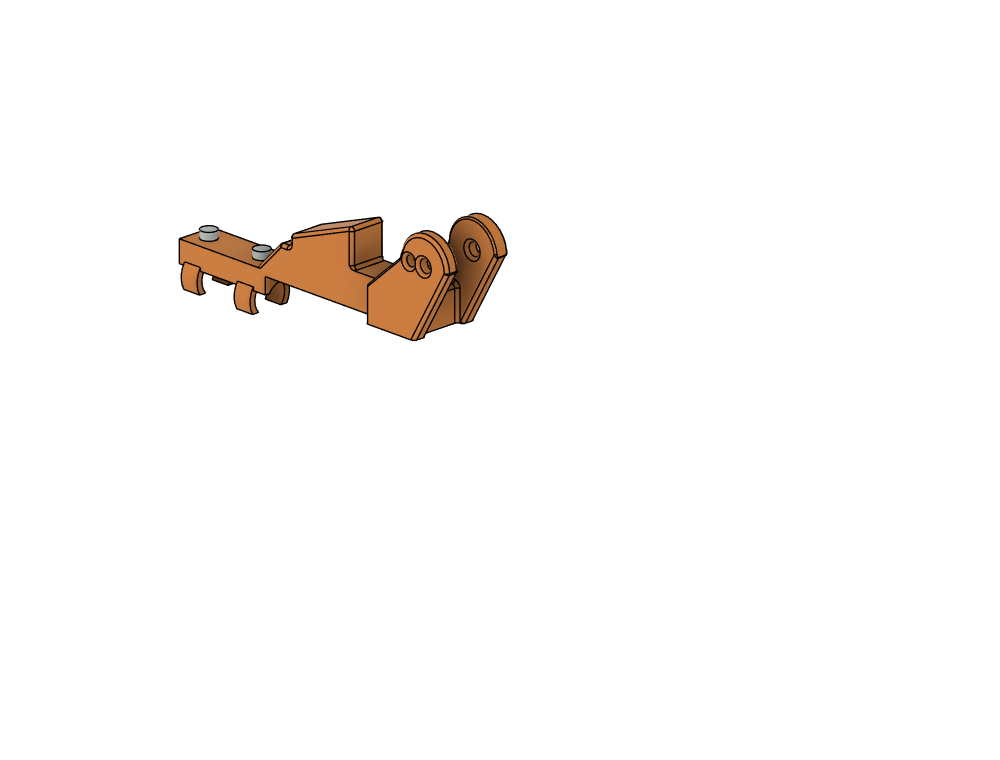

**Parts:** base, 2 M3 × 10 thumb screws

Snap the two clips onto the forearm's **middle** pipe, behind the wrist ring. Thumb screws in from the top until their
tips touch the pipe. Loosen them to slide the whole gripper up to 50 mm forward or back; tighten where it suits your hand.

### 11.2 Fold hinge and lock

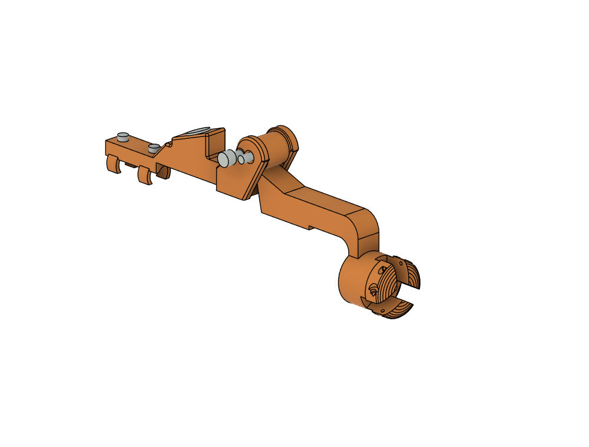

**Parts:** carrier, M8 × 55 + nyloc, index plunger with its lock nut

- Carrier's round knuckle between the base's two cheeks, M8 × 55 through, nyloc snug: it must still turn freely.
- Screw the plunger into the 6.8 mm hole in the outer cheek (it cuts its own thread in the plastic; an M8 tap makes it
  easier), lock nut on the outside. With the gripper pointing forward the pin clicks into the knuckle's first hole.

### 11.3 Claws

**Parts:** 3 TPU claws, 3 M3 × 30

Each claw's round root into its slot in the dome; M3 × 30 in through the wide entry, through the claw, into the insert
in the far wall. Snug only: the claw must swing.

### 11.4 Collar

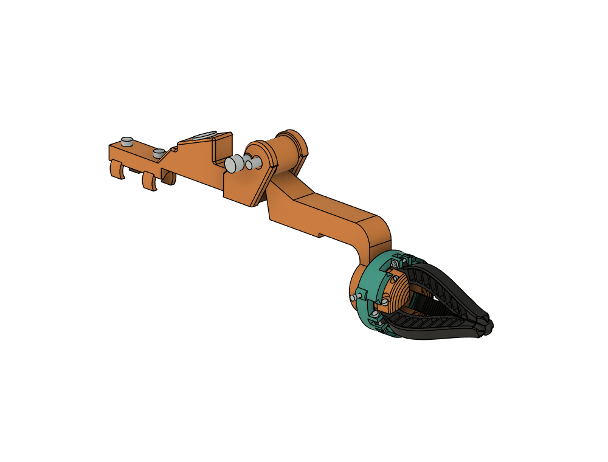

**Parts:** collar, 3 M3 × 20 + 3 nylocs

Slide the collar over the hub so each claw's tail sits between a pair of cheeks. M3 × 20 through the cheeks and the
tail's slot, nyloc on the far side, snug: the tail must slide in its slot.

### 11.5 Grip and trigger

**Parts:** grip, trigger, 4 M3 × 12, M3 × 30

Grip's top plate up under the bridge, 4 × M3 × 12 into the inserts. Trigger between the grip's two cheeks, M3 × 30
through as its pivot.

### 11.6 Y link and spring

**Parts:** Y link, M3 × 20 + nyloc, 2 M3 × 12, extension spring

- Link's stem into the trigger's slot, M3 × 20 + nyloc as the pin (snug, it must turn).
- Its two arms onto the collar's side lobes, M3 × 12 into the inserts (they are pivots: snug, not tight).
- Spring last: one loop through the hook hole on the back of the hub, the other through the link's hole **farthest
  from the hub**. If squeezing is too hard, use the middle hole.

### 11.7 Velcro and check

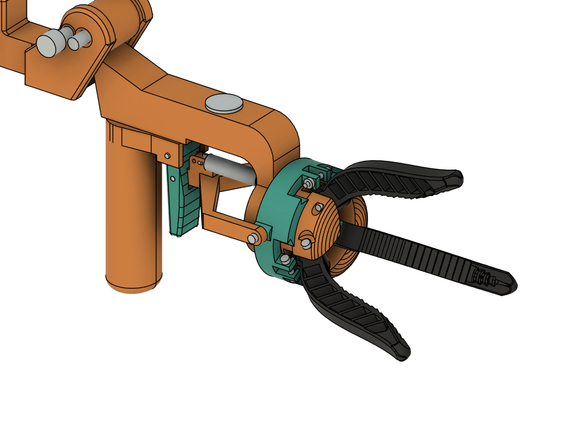

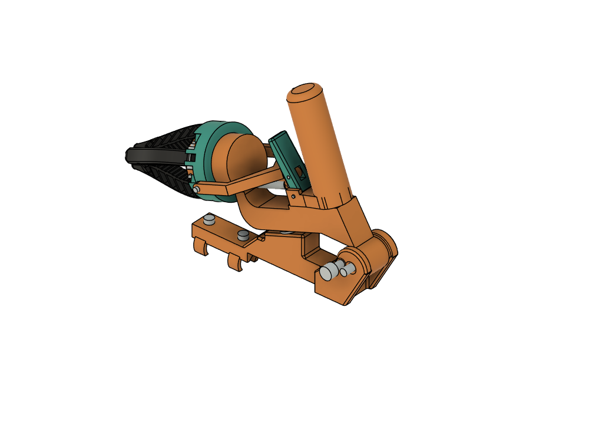

**Parts:** 2 hook-and-loop dots (22 mm)

One dot on top of the bridge, the other on the sloped pad on the base.

**Check:**
- Squeeze: the claws open about 34°. Let go: they snap shut, tips touching.
- Fold: pull the plunger's ring, swing the gripper up and back until the bridge lands on the pad, let go: the pin
  clicks into its second hole and the Velcro holds it.

You built an exo!
