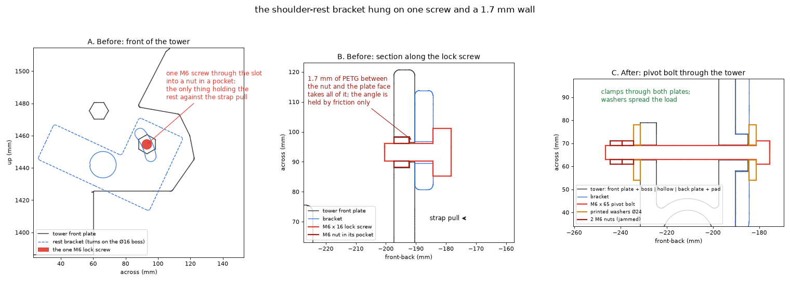

# Shoulder-rest bracket hung on one screw and a 1.7 mm wall

**Where:** shoulder rest bracket (26) on the shoulder tower (07)  
**Status:** fixed in the model; towers already printed get a drilled hole

| | |
|---|---|
| What | The rest bracket turns on a Ø16 boss on the tower's front plate. The only thing holding it on, against the straps pulling forward, was **one M6 screw** through the bracket's arc slot into a nut in a pocket, with **1.7 mm** of plastic between the nut and the plate face. The angle was held by friction alone. |
| How found | The user, after a **9 h print of the tower**: "how is the rest bracket holding onto the tower, given that it will be pulled forward by tight straps?" Nothing in the pipeline asked that question. |
| Cost | One 9 h tower print could have been redone; instead **we drill a Ø6.6 hole** through that tower (boss centre to back plate). New prints have the hole. |
| Root cause | We checked that parts fit and print, never that each joint can carry its load. The MuJoCo sim treats the bracket as welded to the tower, so it could not show this. |
| Fix | An **M6 x 65 socket head** through the bracket, the boss, the front plate, the tower's hollow and its back plate; a printed Ø24 x 3 washer at each end (31); 2 M6 nuts jammed at the back. Both plates share the load, and the clamp holds the angle. The slot screw is gone. |
| What catches it now | `fastener_check.py` (every bought screw must have ≥ 3 mm of material or a nut at its tip; runs before every export and in the pre-commit hook). It catches screws that hold *nothing*. It does **not** judge whether a wall is strong enough: that needs a load check (see README, "next tests"). |

**Note on the diagnosis:** at first I told you the old screw ended "in thin air". That was wrong: see [false-thin-air-diagnosis](false-thin-air-diagnosis.md). The old joint held, just weakly.
