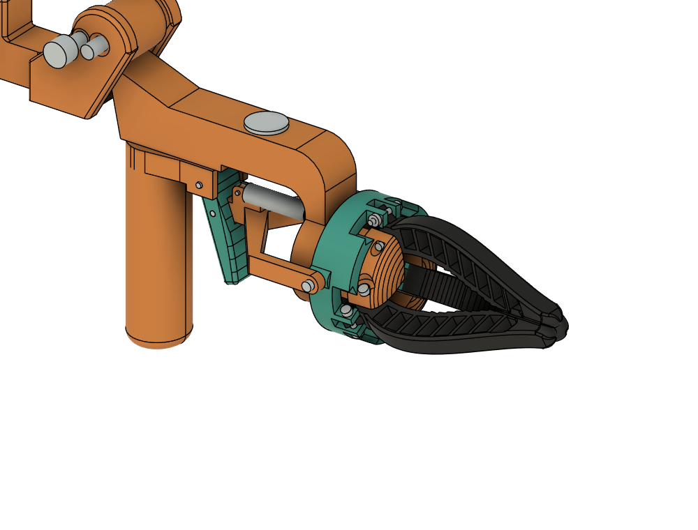

# Grippers

Two gripper designs are kept. Prototype 3 is the one to print; prototype 2 stays for reference.

| | Prototype 3: fold-up, 3 claws (print this) | Prototype 2: slides out over the fist (reference) |
|---|---|---|
| Idea | Pistol grip and trigger on a carrier clamped to the forearm's middle pipe; three C-cup fin-ray claws (TPU) around a hub, right in front of the trigger. Folds up and back over the forearm (index plunger + Velcro). | Two fin-ray claws on a head that slides along an MGN12 rail over the fist; trigger drives the claws through a Bowden cable; damper gear on a printed rack. |
| Script | `cad/fusion/gripper3.py` (design rules in `gripper3.RULES`) | `cad/fusion/gripper.py` |
| Fusion | doc "CDX-3R gripper 3", archive `cad/fusion/models/cdx-3r-gripper-3-foldup.f3d` | doc "CDX-3R gripper", archive `cad/fusion/models/cdx-3r-gripper-2-sliding.f3d` |
| Print files | [prints/gripper3-v1](../../prints/gripper3-v1/) | none |
| Build | [Assembly guide, step 11](../ASSEMBLY.md#11-add-the-gripper-optional) | not built |
| Parts | [BOM: gripper prototype 3](../../BOM.md) | listed in `gripper.py` |

Animations (open the HTML files in a browser): `gripper3_open_close.html` (squeeze), `gripper3_fold.html`
(fold to the Velcro rest), `gripper3_fold_lock.html` (how the plunger locks the hinge), `gripper3_collar_fitting.html` (putting the collar and claws on, guide 11.3-11.4), `proto2_motion.html`
(prototype 2). Concept pages: `wrist_concept.html`, `mount_options.html`.

