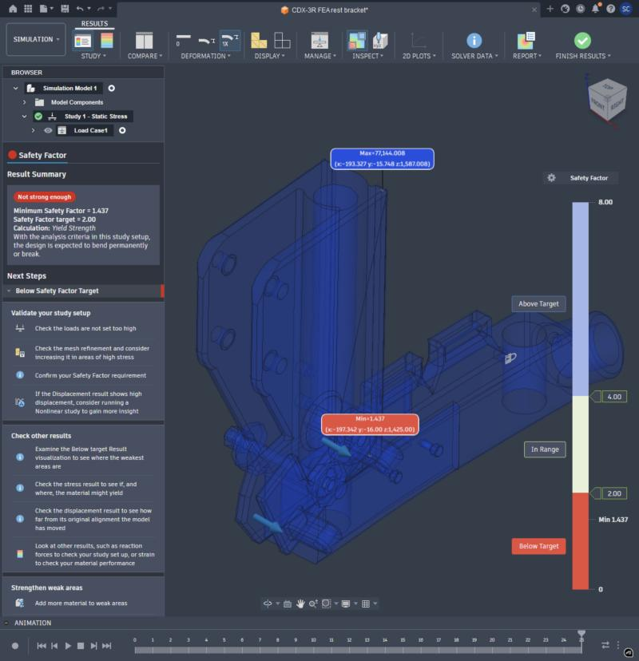
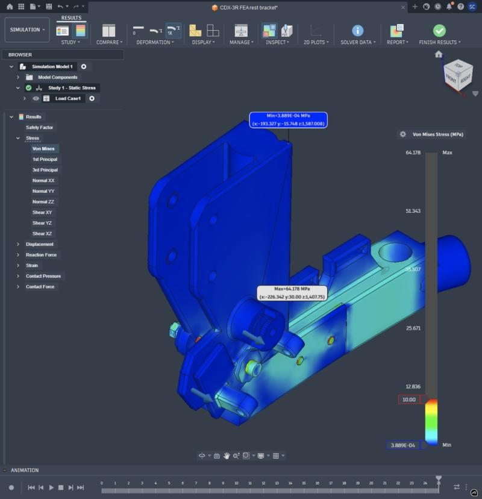
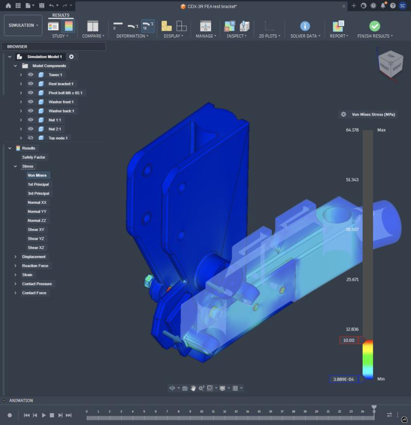
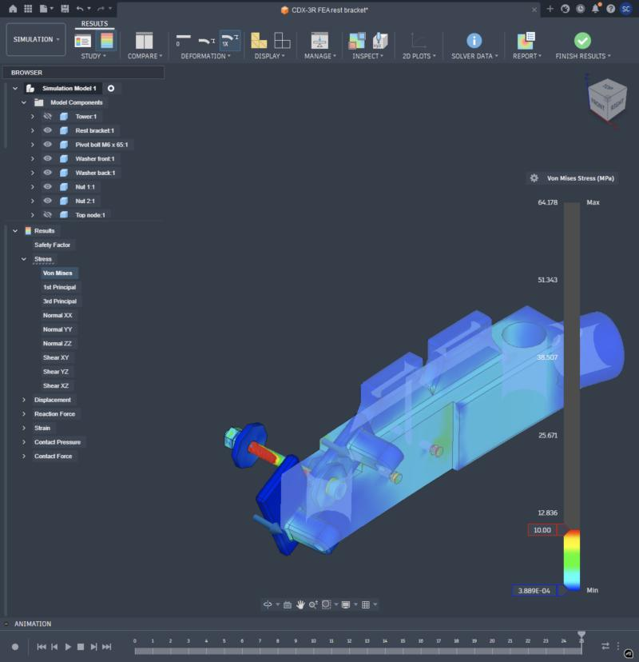
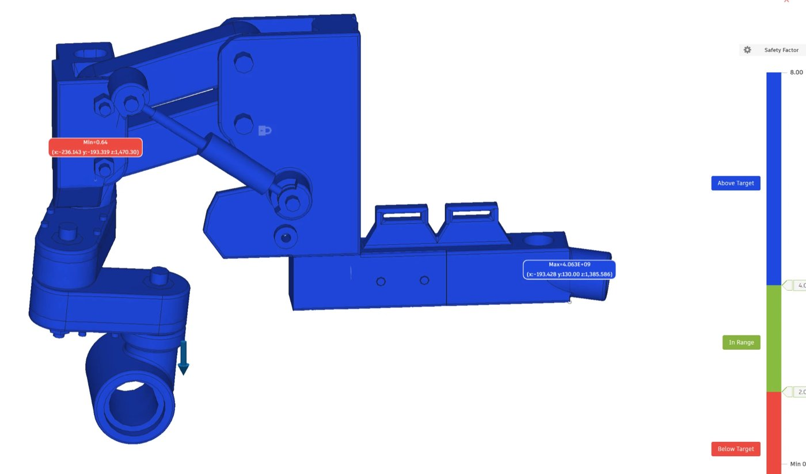
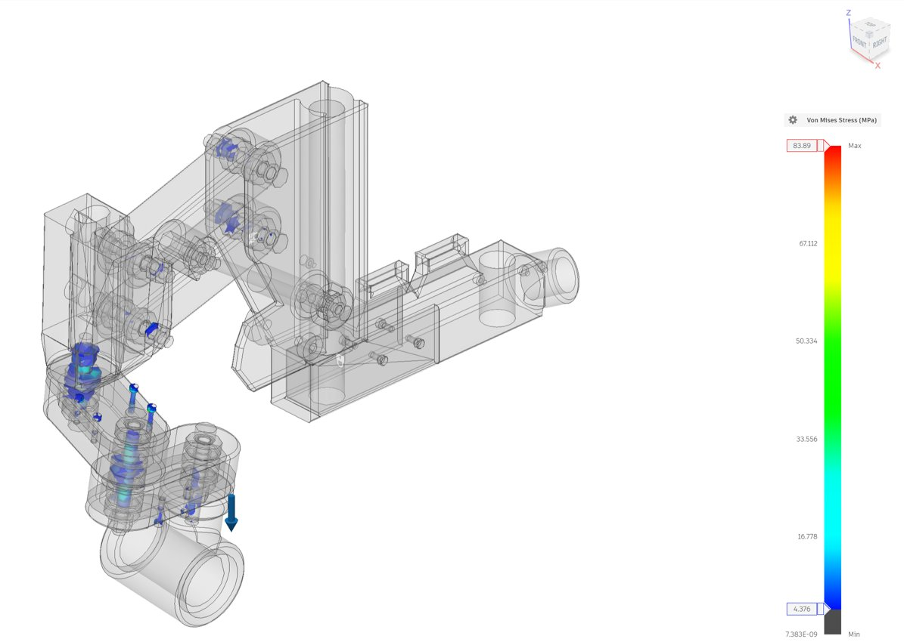
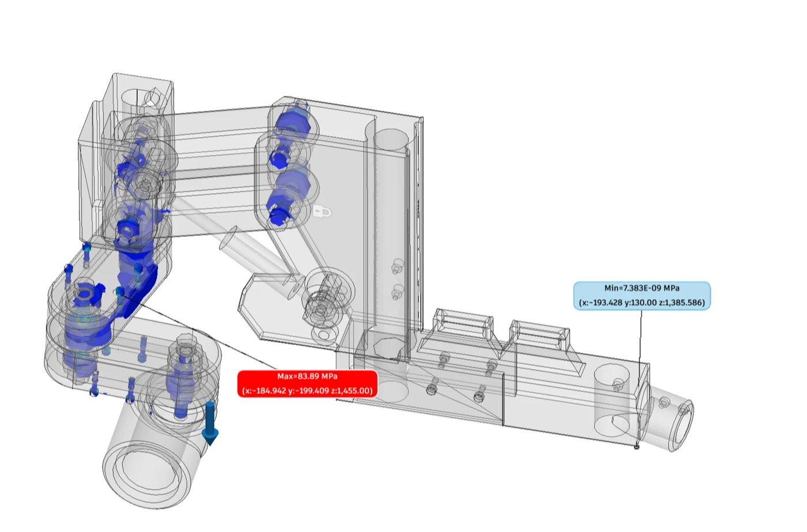

# Stress tests (Fusion Simulation)

Where the printed parts are most loaded, and how far they are from failing. **First passes, for finding weak spots and
building the workflow; the numbers are rough.** How to run one: `docs/PIPELINE-PLAYBOOK.md`, "Stress tests".

**Common setup**

| | |
|---|---|
| Solver | Fusion Static Stress (linear), cloud solve, auto mesh, automatic *bonded* contacts (parts are glued where they touch) |
| Printed parts | "PETG, printed (6 walls, 25% grid)": E 1.9 GPa, yield 30 MPa (layer-to-layer, the weak direction); slicer profile Bambu "0.20mm Strength" |
| Bought parts | steel (bolts, nuts, bearings, inserts) |
| Study documents | built by `cad/fusion/fea.py` from the assembly (my-projects / CDX-3R v3 / "CDX-3R FEA ...") |
| Reading the pictures | von Mises stress, colour scale capped (red = cap or more); safety factor = yield / stress |

## Rest bracket: strap pulls the rest straight off the tower

**Case:** 150 N (95 N peak strap force x 1.5) on the bracket's two hinge knuckles, pulling straight away from the
tower (+x). The tower hangs from the top node by its 4 x M3; the node is held at its PVC socket.

| | |
|---|---|
| Min safety factor | **1.44**, on the top node at the edge the tower's front plate bears on (x -197, y -16, z 1425) |
| Tower | under ~2 MPa almost everywhere (safety factor > 10); one warm corner where it levers on the node's edge |
| Top node | carries the load: 4-6 MPa along its side, hotter rings around the M3 screws |
| Pivot bolt M6 x 65 | bends between the tower's plates (red in the 0-10 MPa scale; steel, fine) |
| Verdict | holds at 150 N. First to go (if anything): the node around the M3 screws / its edge under the tower |

*Safety factor; only the weakest point is marked (min 1.44).*

*Von Mises, 0-10 MPa. The long cyan part is the top node.*

*Same, top node see-through: the tower itself is nearly all blue.*

*Tower hidden: the pivot bolt bending, the node's screw holes.*

**Caveats:** bonded contacts make the edge where the tower meets the node a stress spike (over-estimates it); the real
joint can open, then the M3 screws take it (next run: separation contact). Inserts modelled as steel, really brass.

## Shoulder girdle: arm load hanging from the abduction housing

**Case:** 150 N straight down on the abduction housing (end plate), where the arm hangs: arm weight + peak strap pull.
The whole girdle (93 parts: tower, lift links, carriage, SCARA links 1 and 2, end plate, spool, strut, bearings, bolts)
hangs from the top node, held at its PVC socket. Contacts: automatic at **0.5 mm** (the end plate and the strut sit
0.1-0.3 mm off their neighbours at the bearing / eyelet clearances; at 0.1 mm they float). Study document "CDX-3R FEA
shoulder girdle B" (solved on desktop Fusion; `fea.build_set('girdle')`).

| | |
|---|---|
| Min safety factor | **0.64** (below 1: would yield), on the **lift carriage, at the seat of an M8 nyloc nut** of a lift-link pivot (x -236, y -193, z 1470), ~47 MPa in the PETG |
| Max stress | 83.9 MPa, in an **M3 x 12** that holds SCARA link 1's lid on its tray (steel; fine) |
| Above 4.4 MPa | only the pivot stacks (M8 bolts, spacers, bearings), link 1's lid screws and the area around them; every printed body is below that almost everywhere |
| Verdict | the plastic carries the arm easily; **the weak spots are where steel hardware presses into printed seats**: the carriage under the M8 nut, link 1's lid around its M3 screws |

*Safety factor: min 0.64 at the carriage's M8 nut seat (red label).*

*Von Mises; parts under 4.4 MPa see-through. Colour is only at the pivot stacks and link 1's lid screws.*

*Max 83.9 MPa: an M3 x 12 in SCARA link 1's lid.*

**Caveats:** bonded contacts glue every bearing, bolt and the gas strut solid, so the linkage can't move or share load
as it really does, and nut and screw-head edges become stress spikes (the 0.64 is partly that). Inserts and nuts as
steel. The solve log lists >100 "segments removed in contact element N" warnings: with 0.5 mm automatic contacts,
faces that only partly overlap or don't really touch get paired, and the solver drops the patches it can't bridge, so
some joints are glued over less area than their full face (raises local peaks). Cleaner: 0.1 mm automatic + manual
contacts only at the real clearances (end-plate bearings, strut eyelets). **Worth checking before trusting it:** contact pressure under that M8 nut; a re-run with separation contacts at
the nut / screw seats. **Cheap fixes if it holds up:** a washer under the M8 nyloc on the carriage (spreads the nut's
load ~3x), larger seat; washers under link 1's lid screws.

## Next

- Separation (lift-off) contacts at screw and nut seats instead of bonded.
- More load cases: arm forward (+x) and sideways; the shrug end-stop.
- Inserts as brass, nuts/washers as steel; finer mesh at the hot spots.
